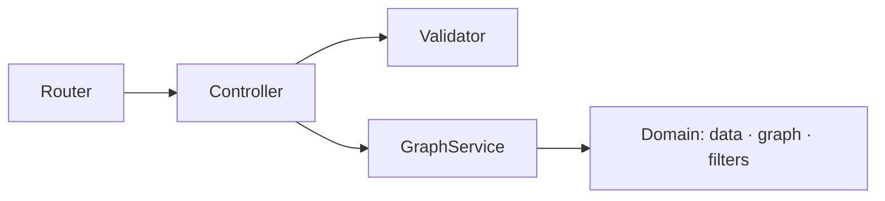

# Train Ticket Microservices — Graph Query API

A TypeScript / Node.js REST API that loads a microservices dependency graph
(`train-ticket-be.json`), finds every call route through it, and returns the routes that
match a set of filters, together with a `nodes` + `edges` graph that is ready to render on
the client.

The three built-in filters describe an **attack path**: enter through a **public** service,
pass through a **vulnerable** one, and reach a **sink** (a database).

## Quick start

Requires Node.js 22+.

```bash
git clone https://github.com/MichaeL5225/TrainTicketMicroService.git
cd TrainTicketMicroService
npm install
npm test        # builds and runs the 32 tests
npm start       # http://localhost:3000/graph
```

Optional environment variables: `PORT` (default `3000`) and `DATA_FILE`
(default `data/graph.json`).

## API

| Endpoint | Returns |
|----------|---------|
| `GET /graph` | All routes and the graph they form |
| `GET /graph?filters=sink,vulnerable` | Only the routes that pass **all** listed filters |
| `GET /filters` | The supported filter names |

| Filter | A route passes if... |
|--------|----------------------|
| `public` | its first service is publicly exposed |
| `sink` | its last node is a database (`kind` is `rds` or `sql`) |
| `vulnerable` | at least one node on it has vulnerabilities |

**Response:**

```json
{
  "routes": [["frontend", "admin-basic-info-service", "station-service"]],
  "nodes":  [{ "name": "frontend", "kind": "service", "publicExposed": true }],
  "edges":  [{ "from": "frontend", "to": "admin-basic-info-service" }]
}
```

- `routes`: each matching route as an ordered list of names.
- `nodes` + `edges`: the union of those routes as one graph, without duplicates. Nodes keep
  all their original fields (language, vulnerabilities, metadata).

**Errors:** an unknown filter returns `400` with the list of valid names, and never a
stack trace:

```json
{ "error": "Unknown filter: xyz", "availableFilters": ["sink", "public", "vulnerable"] }
```

**Results on the provided data:**

| Request | Routes | Nodes | Edges |
|---------|-------:|------:|------:|
| `/graph` | 222 | 47 | 98 |
| `?filters=sink` | 30 | 21 | 40 |
| `?filters=vulnerable` | 60 | 23 | 42 |
| `?filters=public` | 6 | 8 | 6 |
| `?filters=public,sink` | 0 | 0 | 0 |

`public,sink` is empty because the two public services never reach the database in this
data set.

## Design



- **Layers:** router → controller → validator → service → domain. Only the HTTP layer
  knows Express, so the logic can be tested and reused without a server.
- **Compute once:** loading, normalizing, and finding all routes (DFS) happen once at
  startup. Each request only filters the ready routes and builds the response.
- **Route = a full path** from an entry point (a node nobody calls) to a leaf (a node that
  calls nobody). Cycles are detected per path, so the walk always ends.
- **Normalize at the boundary:** the file's `to` field is sometimes a string and sometimes
  an array; it is normalized once at load time. The file's shape is validated at startup.
- **Generic filters:** each filter is a function with one signature, registered by name in
  a `Map`. Multiple filters are combined with AND.
- **Assumptions:** `sqs` (a message queue) is not a sink. `assurance-service`, which edges
  point to but which is not defined in the file, is returned as `kind: "unknown"`.

### Adding a filter

Write one function and register it. Nothing else changes, and `GET /filters` lists it
automatically.

```ts
// src/filters/allJava.ts - passes if every service on the route is written in Java
export function allJava(route: string[], nodesByName: Map<string, GraphNode>): boolean {
    return route.every(name => nodesByName.get(name)?.language === "java");
}
```

```ts
// src/filters/registry.ts
export const FILTERS = new Map<string, RouteFilter>([
    ["sink", endsInSink],
    ["public", startsInPublic],
    ["vulnerable", hasVulnerability],
    ["java", allJava],   // ← new filter
]);
```

## Project structure

```
src/
├── server.ts · app.ts · config.ts
├── routes/ · controllers/ · validators/   # HTTP layer
├── services/                              # GraphService
├── data/ · graph/ · filters/              # domain logic
├── types/ · errors/
└── tests/                                 # node:test suites
```

## Limitations

- Listing every route can grow exponentially on a large, dense graph. The next step would
  be marking the reachable nodes first and returning routes on demand, with pagination.
- Filters can only be combined with AND (no OR or negation yet).

More detail on the data, decisions, testing, and complexity:
[docs/DESIGN.md](docs/DESIGN.md).
