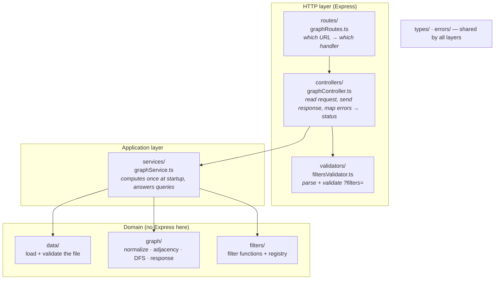
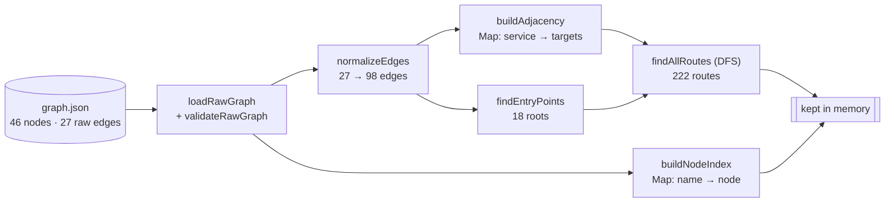
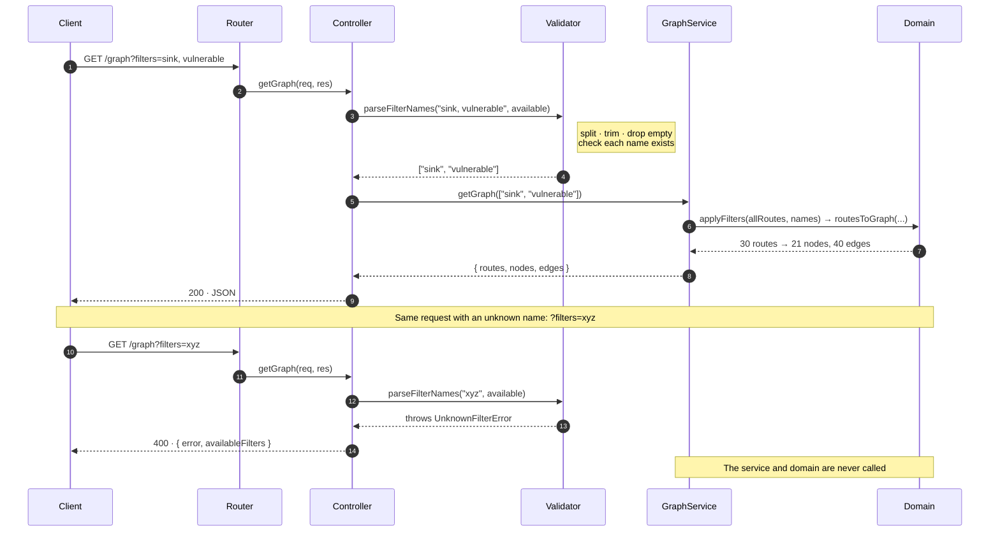

# Design notes

The full reasoning behind the [README](../README.md): data findings, architecture,
request flow, every major design decision with its alternative, error handling,
testing approach, complexity, and limitations.

---

## Understanding the data

Findings from `train-ticket-be.json` that shaped the design:

- **46 nodes:** 44 `service`, 1 `rds` (`prod-postgresdb`), 1 `sqs` (`prod-sqs`).
- **27 edge records** in the file, which become **98 single edges** once each
  `from → [targets]` record is split into pairs.
- **2 public services:** `frontend`, `gateway-service`.
- **2 vulnerable services:** `auth-service` (1 finding) and `order-service` (2 findings).
- Infrastructure nodes (`rds`, `sqs`) have no `language` / `path` / `publicExposed`;
  instead they carry a `metadata` object whose keys differ per node.
  Every vulnerability has a `metadata` object with one fixed key: `cwe`.
- **No cycles** in the provided graph, but the code is protected against them.

### Inconsistencies found in the data

| # | Issue | How it is handled |
|---|-------|-------------------|
| 1 | In the `consign-service` edge, `to` is a **string** instead of an array. | Normalized once at load time; the rest of the code only sees one-target edges. |
| 2 | `assurance-service` is the target of edges but is **not defined** in `nodes`. | Returned as `{ "name": "assurance-service", "kind": "unknown" }` so every edge has both ends. Not considered public, sink or vulnerable: there is no evidence for it. |
| 3 | Two findings whose message describes **SQL injection** are tagged `CWE-22` (Path Traversal) instead of `CWE-89`. | Data is returned as-is; documented here. |

---

## Assumptions and definitions

- **Route = a full path, from an entry point to a leaf.**
  - *Entry point* (root): a node that no other node calls.
  - *Leaf*: a node that calls no other node.
  - This shows every flow from its beginning to its end without hundreds of duplicated
    sub-paths, which is what attack-path analysis cares about.
  - A node with no edges at all (`avatar-service`, `news-service`), or an entry point
    with no outgoing calls (`gateway-service`), is a route of **one node**.
  - On the provided data: 18 entry points, 222 routes.
- **Sink = `rds` or `sql`**, as the exercise defines it. `sql` does not appear in the
  data but is supported. `sqs` (a message queue) is **not** a sink: it passes messages on
  rather than storing data long-term, and the exercise does not list it. The decision
  lives in a single constant (`SINK_KINDS`), so changing it is a one-line change.
  (30 routes end in `rds`; 3 end in `sqs`.)
- **Multiple filters = AND.** Each filter narrows the result, like filters on a
  shopping site. That is also the interesting case for security: routes that are risky
  in every respect. **No filters = all routes.**
- **`severity` is a `string`**, not a closed union, because the data only shows some of
  the possible values.

---

## Architecture

The code is split into layers. Each layer has one responsibility and only talks to the
layer below it.



```
src/
├── server.ts                 # entry point: creates the service + app, calls listen()
├── app.ts                    # createApp(service): builds the Express app (no listen → testable)
├── config.ts                 # PORT, DATA_FILE (from env, with defaults)
├── routes/graphRoutes.ts     # GET /graph, GET /filters
├── controllers/graphController.ts
├── validators/filtersValidator.ts
├── services/graphService.ts
├── data/
│   ├── loader.ts             # read file → JSON.parse → validateRawGraph
│   └── validateRawGraph.ts   # checks the file's shape at runtime
├── graph/
│   ├── normalize.ts          # raw edges (to: string | string[]) → one-target edges
│   ├── build.ts              # adjacency Map, entry points, node index
│   ├── routes.ts             # DFS: all full routes, with cycle guard
│   └── response.ts           # routes → { routes, nodes, edges } (deduplicated)
├── filters/
│   ├── endsInSink.ts · startsInPublic.ts · hasVulnerability.ts
│   ├── registry.ts           # Map: filter name → filter function
│   └── applyFilters.ts       # generic: looks names up, keeps routes passing all of them
├── errors/                   # UnknownFilterError, InvalidDataFileError
├── types/                    # raw.ts (input), graph.ts, filters.ts, api.ts (output)
└── tests/                    # node:test suites
```

Why this split:

- **Swapping the data source** (a database, another API) only touches `data/`.
- **Swapping the web framework** only touches `routes/`, `controllers/` and `app.ts`;
  the service and domain have no Express imports.
- **`app.ts` is separate from `server.ts`**, so tests can build the app and run it on a
  temporary port chosen by the operating system (`listen(0)`), without running
  `server.ts` on port 3000. The test closes that temporary server when it finishes.

---

## How a request flows

### At startup (once)



The file does not change while the server runs, so loading, normalizing, building the
structures and running the DFS happen **once**, in the `GraphService` constructor.

### On every request



Per request, only filtering and building the response run.

---

## Adding a new filter

A filter is a plain function with one signature:

```ts
type RouteFilter = (route: string[], nodesByName: Map<string, GraphNode>) => boolean;
```

Adding one takes **one function and one registry line**. Nothing else changes: not the
validator, controller, service, `applyFilters`, or `GET /filters`.

```ts
// src/filters/allJava.ts
export function allJava(route: string[], nodesByName: Map<string, GraphNode>): boolean {
    return route.every(name => nodesByName.get(name)?.language === "java");
}

// src/filters/registry.ts
export const FILTERS = new Map<string, RouteFilter>([
    ["sink", endsInSink],
    ["public", startsInPublic],
    ["vulnerable", hasVulnerability],
    ["java", allJava],            // ← the only new line
]);
```

`GET /graph?filters=java,sink` now works, `GET /filters` lists it, and an error response's
`availableFilters` includes it.

`applyFilters` knows nothing about any specific filter; it only looks names up in the
registry and keeps the routes for which every selected function returns `true`.

---

## Design decisions

The most important choices, with the alternative considered and the reason.

### Language and tooling

| Decision | Alternative | Why |
|----------|-------------|-----|
| **TypeScript on Node.js** | C# or Python (languages I already knew) | The team's stack and the exercise's preference. Its syntax is familiar coming from C, and its type system is close to C#'s. |
| **Strict `tsconfig`** (`strict`, `noUncheckedIndexedAccess`, `verbatimModuleSyntax`) | Default settings | `noUncheckedIndexedAccess` forces handling the "lookup found nothing" case, exactly the `assurance-service` situation. |
| **ES Modules** (`"type": "module"`, `nodenext`) | CommonJS | The modern standard. Cost: local imports end in `.js`. |
| **Express 5** | Raw `node:http`, Fastify | The most common REST library for Node; the counterpart of ASP.NET Web API. |
| **`node:test`** + `node:assert/strict` | Jest / Vitest | Zero extra dependencies, fast (~0.15 s for the whole suite), enough for this project. |

### Data and types

| Decision | Alternative | Why |
|----------|-------------|-----|
| **Separate raw and normalized types:** `RawGraphEdge` (`to: string \| string[]`) in, `GraphEdge` (`to: string`) out | Check "string or array?" everywhere | Normalize once, at the boundary. The rest of the code only sees clean data, and the compiler knows it. |
| **Two representations of the same edges:** an adjacency `Map` for the algorithm, a flat `{from, to}` list for the response | One representation | The DFS asks "where can I go from here?" at every step; a renderer wants one arrow per pair. Splitting 27 records into 98 pairs adds no information (the targets were already inside the arrays): it costs O(E) once at startup, and the DFS reads only the Map, so its cost is unaffected. |
| **One `GraphNode` interface** with optional fields | Discriminated union (`ServiceNode \| InfraNode`) | Simpler and sufficient. Field access is concentrated in the filters, so moving to a union later is a local change. Listed as future work. |
| **Node `metadata` is `Record<string, string>`; vulnerability metadata is a fixed `VulnerabilityMetadata { cwe }`** | One generic metadata type | Node keys vary per node; the vulnerability key is known. |
| **Validate the data file at load time** (`validateRawGraph(data: unknown)`) | Trust `JSON.parse(text) as RawGraphFile` | `as` is a promise to the compiler, not a check. A broken file would otherwise fail later, deep in the DFS, with an unrelated message. Now it fails at startup with a clear `InvalidDataFileError` (e.g. `edges[5] ...`). Only the fields the code uses (`name`, `kind`, `from`, `to`) are checked. |

### Routes and the algorithm

| Decision | Alternative | Why |
|----------|-------------|-----|
| **Full routes only** (entry point → leaf) | Routes from every node | Avoids hundreds of duplicated sub-paths; every flow is shown start to finish. |
| **Recursive DFS with a per-path cycle guard** (`path.includes(next)`) | A global `visited` set | We want *all* routes, not just reachability. The same node (e.g. `station-service`) appears on many different routes, and a global `visited` set would drop them. On a cycle, the route is kept up to the node before the repeat, and the search continues to the next target. |
| **`[...path, next]`** (a new array per step) | `path.push(next)` | `push` mutates the shared array, mixing routes up when backtracking. |
| **Compute once at startup** | Recompute per request | The file does not change at runtime. Cost: all routes stay in memory (negligible here). |
| **`Map` / `Set` for lookups** (`nodesByName`, adjacency, entry points, dedup) | Arrays | O(1) lookups and membership checks instead of linear scans. |
| **Deduplicate edges with a `Set` of `"A->B"` strings** | A `Set` of edge objects | A `Set` compares objects by reference, not content. |

### Filters and the API

| Decision | Alternative | Why |
|----------|-------------|-----|
| **Named filters**, each a function, plus a registry | A generic query language in the URL (`?where=language:java`) | Each filter's logic differs (first node / last node / any node; a list of values; a non-empty array). A general query language would be complex and hard to test. Listed as future work. |
| **Explicit registry** | Derive the API name from the function name | Decouples API names from code names (renaming a function does not break clients), controls what is exposed, and powers `availableFilters` and `GET /filters`. |
| **The registry is a `Map`** | A plain object | A plain object inherits `Object.prototype`: during review, `?filters=constructor` silently returned everything, and `?filters=hasOwnProperty` / `__proto__` crashed with a 500 and a stack trace. `Map.get` only returns what was explicitly added. |
| **Response `{ routes, nodes, edges }`** | Only `nodes` + `edges` | With only the graph, it was hard to see where each route starts and ends. The exercise talks about filtering *routes*. |
| **Missing node → `kind: "unknown"`** | Drop it | Dropping it would leave an edge pointing at a node that does not exist in the response. |

---

## Error handling and security

- **400, not 500, for user mistakes.** An unknown filter throws a dedicated
  `UnknownFilterError`. The controller turns *that type only* into a 400 with
  `{ error, availableFilters }`; any other error is re-thrown as a real 500. The custom
  type is what tells "the user asked for something wrong" apart from "the server has a bug".
- **No stack traces in responses** (CWE-209, information exposure through error
  messages): no file paths, library names, or internals leak to the caller.
- **Defense in depth.** The validator rejects unknown names before the service is
  called, and `applyFilters` also throws `UnknownFilterError` for an unknown name, so the
  service stays safe even if it is called without the validator.
- **No prototype lookups** thanks to the `Map` registry (see above). Locked in by a
  regression test.
- **`X-Powered-By` disabled**, so the server does not advertise that it runs Express.
- **Input normalization:** `split(",")` → `trim` → drop empty names. Only a single
  string parameter is accepted; anything else is treated as "no filters".

---

## Testing

```bash
npm test     # = npm run build && node --test dist/tests/*.test.js
```

**32 tests, ~0.15 s.** Tests live in `src/tests/` and are compiled by the same strict
`tsconfig` as the code. `&&` means tests only run if the build succeeds.

| File | What it checks |
|------|----------------|
| `routes.test.ts` | DFS on hand-built graphs: a chain, a branch, a single node, and a cycle `A → B → A` that terminates as `[["A","B"]]`. |
| `filters.test.ts` | The three filters, including a route ending in `sqs` (not a sink) and a node with no info (skipped, not a crash). |
| `filtersValidator.test.ts` | Splitting, trimming, empty names, no parameter → `[]`, unknown name → error, `constructor` → error. |
| `validateRawGraph.test.ts` | A valid file with a string `to` passes; missing `edges`, a node without `name`, a numeric `to` → `InvalidDataFileError`. |
| `graphService.test.ts` | Known numbers on the real file: 222 / 47 / 98, `sink` 30 / 21 / 40, `public` 6, `public,sink` 0, the filter list, and that an unknown name is rejected even without the validator. |
| `api.test.ts` | Real HTTP requests against `createApp` on a random free port (`listen(0)`): 200, 400 with `availableFilters`, `GET /filters`, no `X-Powered-By`, and 404. |

Testing approach:

- **Logic tests use small hand-built data** (`A`, `B`, `C`; `web`, `api`, `db`, `queue`,
  `ghost`), so the expected result is obvious, each test checks one thing, and cases that
  do not exist in the real file (a cycle, a queue at the end) can still be tested.
  The real file is only used in the service and API tests.
- **Some tests lock decisions**, not just behaviour: "`sqs` is not a sink" and "a node with
  no info is skipped". If someone changes a decision by accident, a test fails and its
  name says what broke.
- **Regression tests for fixed bugs:** `?filters=constructor`, and the cycle.

---

## Complexity

Let *V* be nodes, *E* edges, *R* the number of routes, *L* the longest route, and *F* the
number of selected filters.

| Step | When | Cost |
|------|------|------|
| Load, validate, normalize, adjacency, entry points, node index | once | O(V + E) |
| Enumerate all routes (DFS) | once | O(R · L) (plus the per-path cycle check) |
| Apply filters | per request | O(R · L · F) worst case; a route is rejected at its first failing filter |
| Build the response (dedup nodes and edges) | per request | O(R · L) |

On the provided data (R = 222) every request is effectively instant.

---

## Limitations and future work

- **Scalability of route enumeration.** The number of full routes can grow
  exponentially in a large, dense graph. For such a graph, the subgraph for the attack-path
  query could be computed with **reachability** instead of enumerating every route:
  forward from public services, backward from sinks, then intersect with the nodes that can
  reach a vulnerable node. Individual routes would then be returned on demand, with
  **pagination** or a limit.
- **Caching** the response per filter combination (the data is static, so results never
  go stale).
- **Discriminated union** for nodes (`ServiceNode | InfraNode`), so the compiler knows which
  fields exist for each `kind`.
- **Richer queries:** a generic field filter (`?where=language:java`), OR between filters,
  and negation (`!public`).
- **Repeated query parameter** (`?filters=a&filters=b`) currently arrives as an array and
  is treated as "no filters"; it could be supported or rejected with a 400.
- **Cycles:** if a node has several targets already on the current path, the same partial
  route can be recorded more than once. A cycle that no entry point can reach would not
  appear in the results. (Neither case occurs in the provided data.)
- **Entry points** are computed from the defined nodes; a service that only appears as an
  edge's `from` and not in `nodes` would not be treated as an entry point (does not occur
  in the provided data).
- **Full schema validation** of the input file (the current validation checks only the
  fields the code relies on).
